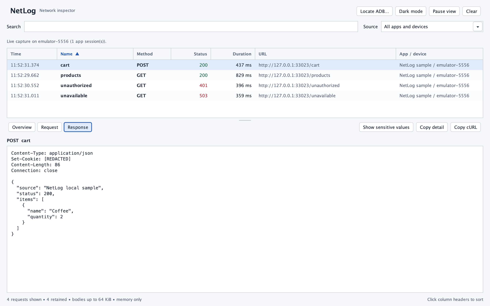
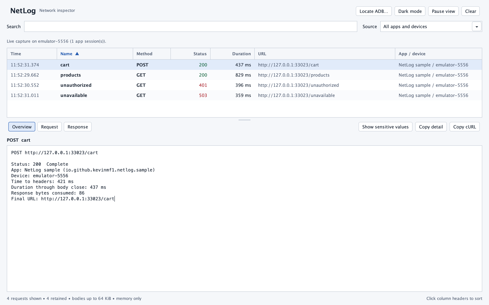
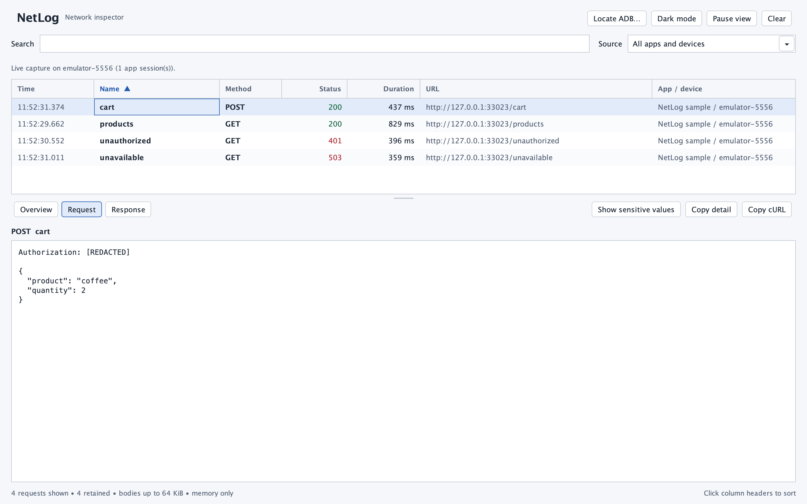
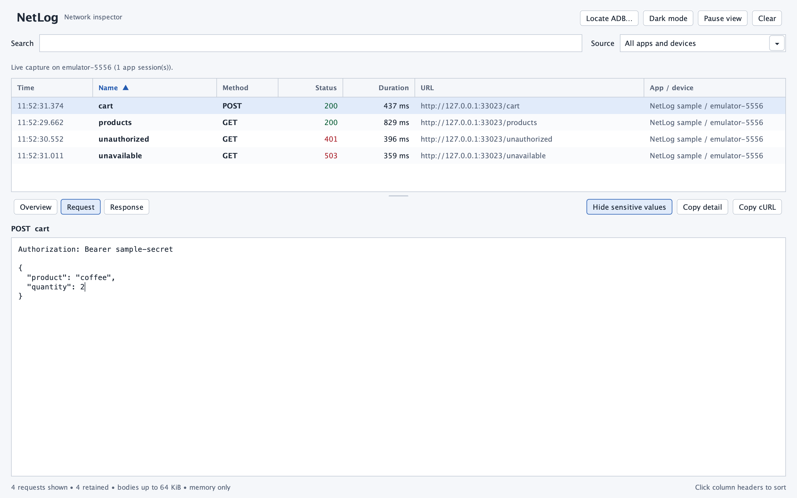
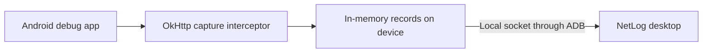

# NetLog

See what your Android app sends and what the server returns, right on your desktop.

NetLog captures OkHttp requests from your debug app and shows their headers, bodies, status codes, and timing. Connect a USB phone or start an emulator, open your app, and requests appear in NetLog. You don't need to set up a proxy, install a certificate, or enter an IP address.



*Captured with the bundled NetLog sample app on an emulator. All data and credentials are demo values. [Screenshot details](docs/screenshots/README.md).*

[Try the sample](#try-it-with-the-sample-app) · [Set up your app](#set-up-your-app-once) · [How it works](#how-it-works)

## What you can do

- Find a failing request by endpoint, URL, method, status, or app.
- Read request and response bodies as formatted JSON.
- Copy a request as cURL to replay it in your terminal.
- Hide common authentication headers and URL secrets in both the view and copies.
- Inspect several apps and devices, with a filter to focus on one source.

NetLog works with OkHttp 4.x and 5.x, including Retrofit clients that use them. Your Android app needs `minSdk` 24 or higher. The Gradle plugin adds capture to debuggable builds; non-debuggable builds stay untouched.

## Set up your app once

The library and plugin are currently local snapshots. Build them from this repository before adding NetLog to another Android project.

### 1. Publish the library and plugin locally

Run these commands from the NetLog repository:

```sh
./gradlew :netlog:publishReleasePublicationToMavenLocal
./gradlew -p netlog-gradle-plugin publishToMavenLocal
```

You need JDK 17+, Android SDK 36, and SDK platform-tools to build this project.

### 2. Let your Android project find them

In your app project's `settings.gradle.kts`, add `mavenLocal()` to both repository blocks. Keep the other repositories your project already uses.

```kotlin
pluginManagement {
    repositories {
        mavenLocal()
        google()
        mavenCentral()
        gradlePluginPortal()
    }
}

dependencyResolutionManagement {
    repositories {
        mavenLocal()
        google()
        mavenCentral()
    }
}
```

### 3. Apply the plugin to your app module

In the app module's `build.gradle.kts`, add NetLog alongside your Android plugin:

```kotlin
plugins {
    id("com.android.application")
    id("io.github.kevinmf1.netlog") version "0.1.0-SNAPSHOT"
}
```

Rebuild and run a debug variant. The plugin adds the capture library and connects it to the app's OkHttp clients, including clients created by SDKs. You don't need to edit each client or add an interceptor yourself.

Using an older Gradle setup, or prefer adding an interceptor manually? See [alternative setup and compatibility notes](docs/technical-details.md#plugin-compatibility-and-legacy-setup).

## Open NetLog and inspect a request

### Connect your device

Start an Android emulator, or connect a phone by USB. On a phone, enable USB debugging and accept the computer's authorization prompt. Then open the debug app you rebuilt with NetLog.

### Open the desktop app

Build the macOS app from this repository:

```sh
./gradlew :desktop:packageMac
open desktop/build/app/NetLog.app
```

The package includes Java and ADB. After building it, you can open `NetLog.app` directly without setting those up separately. Close NetLog before rebuilding the package.

Builds are for local use on the Mac that creates them. A notarized public download isn't provided. See [build details](docs/technical-details.md#build-and-test) for other operating systems and distribution notes.

### Use your Android app

Open a screen or trigger an action that makes an API call. NetLog discovers connected apps automatically and adds their requests to the table. Use Search to narrow the list, or Source to choose an app and device. Click a column header to sort.

Search for `401` to focus on authentication failures, or select a request and open Overview to check its URL, status, and timing:



### Inspect and copy

Select a request, then choose a detail view:

| View or action | What it shows or copies |
| --- | --- |
| Overview | URL, status, app, device, and timing |
| Request | Outgoing headers and body |
| Response | Incoming headers and body, with a preview for supported images |
| Copy detail | The text in the current detail view |
| Copy cURL | A terminal command for the selected request |

Sensitive values start hidden. Click **Show sensitive values** to reveal supported authentication headers and URL secrets, including in copies. Click **Hide sensitive values** to mask them again. Body fields are not automatically hidden, so review payloads before sharing screenshots or copied text.

Here is the sample's `POST /cart` request with its authorization header hidden:



<details>
<summary>See Show sensitive values with a dummy token</summary>

The same request after clicking **Show sensitive values**. The token `sample-secret` is only used by the local sample app.



</details>

## Try it with the sample app

You can test NetLog before changing your own app. The bundled **NetLog sample** sends four requests to a server running inside the sample itself. It uses dummy data and needs no account or external API.

With an emulator running, or one authorized device connected:

```sh
./gradlew :sample:installDebug
```

Open **NetLog sample** on the device, then open NetLog on your desktop. The sample sends these requests on launch; tap **Send test requests** to send another batch.

| Request | Result |
| --- | --- |
| `GET /products` | `200`, with sample product JSON |
| `GET /unauthorized` | `401`, an authentication error example |
| `GET /unavailable` | `503`, a server error example |
| `POST /cart` | `200`, with a JSON request body |

The sample already applies the plugin and uses the library from this checkout, so you can skip the Maven Local setup above.

## How it works



During a debug build, the Gradle plugin adds an interceptor to OkHttp clients. The interceptor records request details as the app sends them, then records the response as the app reads it. Your app keeps using its normal server connection.

The library holds a limited set of records in device memory. The desktop finds NetLog-enabled apps through ADB and reads those records over a local socket. The same connection works for emulators and USB phones. Capture records aren't uploaded to a cloud service or saved to disk by NetLog.

## A few things to know

- NetLog captures OkHttp traffic from apps that include it. WebView, Cronet, `HttpURLConnection`, and native sockets aren't covered.
- Text bodies are limited to 64 KiB per direction. Some binary, encoded, or unsupported bodies are omitted.
- Response bodies appear as the app reads them. An unread response can remain in `Reading body`.
- Image previews make a separate request from the desktop, using the original request headers. They load only when you open Response; device-local URLs aren't fetched.
- Pause freezes the view while capture continues. Clear removes the retained desktop rows; device-held records can appear again after reopening NetLog.

For exact memory limits, manual integration, image formats, and transport behavior, read the [technical details](docs/technical-details.md).

## No requests appearing?

| What you see | What to check |
| --- | --- |
| No device detected | Start an emulator, or connect a phone with USB debugging enabled. |
| Device unauthorized | Unlock the phone and accept its USB debugging prompt. |
| Device detected, no live capture | Rebuild and open a debuggable app with the NetLog plugin applied. |
| Connected, but no matching rows | Clear Search, choose the right Source, resume the view, and trigger an OkHttp request. |
| ADB isn't available | Use **Locate ADB…** to select your Android SDK's `platform-tools/adb`. |

## License

Copyright 2026 Kevin Malik Fajar (kevinmf1)

Licensed under the Apache License, Version 2.0. See [LICENSE](LICENSE). Redistributions must keep the copyright notice and the [NOTICE](NOTICE) file.
